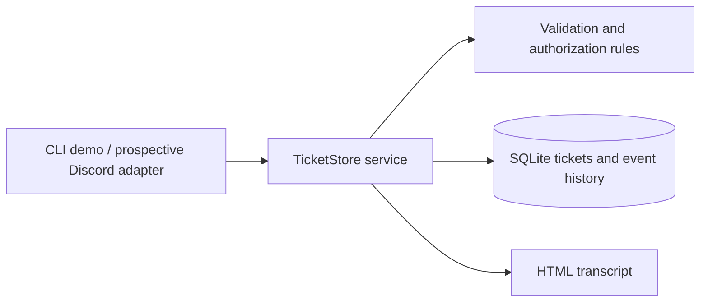

# Discord Ticket System — Python Backend Demo

**A commercial Discord support-workflow case study with a separate, runnable SQLite backend demonstration.**


[](https://github.com/Scumbagsss/advanced-discord-ticket-bot/actions/workflows/python-demo.yml)

> The original Discord bot remains **private**. The public `ticket_demo.py` is a **new, independent teaching/demo implementation** using fictional users, local SQLite storage and standard-library Python. It does not copy production code, authenticate a Discord member or connect to a real server.

## Why this matters

A support ticket is a workflow, not just a chat channel. It needs an owner, assigned staff, permission checks, explicit state changes, a resolution reason and reliable historical records. The private Discord system provides interactive request categories, staff assignment, ticket statuses and HTML transcripts.

This repository demonstrates several of those **backend engineering concerns in a runnable, synthetic implementation**, independently of the proprietary production application.

## Run locally

Requires **Python 3.11 or newer**. No pip installation, Discord token, API key or external service is required.

```bash
python ticket_demo.py --db demo-tickets.sqlite3
```

The program creates a fictional ticket, assigns it, starts review, closes it and prints its state plus audit events as JSON. It creates a local database file. Do not commit that file.

Run the tests:

```bash
python -m unittest discover -s tests -v
```

GitHub Actions runs the same unit suite on Python 3.11, 3.12 and 3.13.

## Features in the **runnable demo**

- SQLite persistence with parameterized queries and explicit state constraints.
- Typed `Actor` identity object (authentication is deliberately **out of scope**).
- `open → in_progress → closed` state changes.
- Staff-only assignment, progression and closure.
- Transactional updates with `BEGIN IMMEDIATE` for competing state writes.
- Idempotent assignment/start operations to avoid duplicate audit entries.
- Timestamped audit history and basic HTML transcript generation.
- Input validation, basic HTML escaping and a synthetic CLI scenario.
- Automated unit tests without private fixtures or third-party dependencies.

## Architecture



The public code is intentionally small. The `Actor` is trusted input from the caller: **it must not be instantiated from an unverified API request or Discord user-controlled payload**. Production-facing adapters would need authentication, request rate limits, staff role verification and observability.

## Production project: private case study

The commercial Discord workflow includes category-specific forms, ticket channel management, assignment, additional participants and HTML exports. The complete implementation and runtime configurations are not publicly released.

| Capability | Public demo | Private Discord system |
|---|---|---|
| Ticket creation and lifecycle | Yes — local SQLite | Discord interactions |
| Staff permissions | Simplified trusted `Actor` | Discord role/staff checks |
| Audit events | SQLite history | Operational audit |
| HTML transcript | Basic escaped HTML | Discord transcript export |
| Discord events and persistent UI | No | Private |
| External API authentication | No | Environment-specific |
| Production deployment | No | Private |

Existing [`src/public_interface.py`](src/public_interface.py) remains an **unimplemented, non-runnable architectural sketch**, separate from `ticket_demo.py`.

## Repository guide

- [`ticket_demo.py`](ticket_demo.py) — independent runnable demonstration
- [`tests/test_ticket_demo.py`](tests/test_ticket_demo.py) — 19 synthetic unit cases
- [`.github/workflows/python-demo.yml`](.github/workflows/python-demo.yml) — automated checks
- [`docs/ARCHITECTURE.md`](docs/ARCHITECTURE.md) — architecture of the private workflow
- [`NOTICE.md`](NOTICE.md) — the private/public boundary

## Trade-offs

This is **not a deployable Discord bot or production API service**. It intentionally omits persistent Discord views, actor authentication, distributed workers, retry/backoff orchestration, multi-tenant isolation, migrations and production-grade access controls.

**Author:** [Scumbagsss](https://github.com/Scumbagsss) · Python Backend / Automation

**Contact:** Discord — `scumbagsss` · Telegram — [@dilarion](https://t.me/dilarion).
